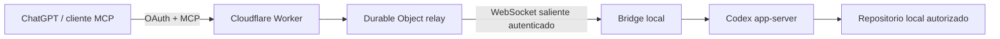

# SolicitudPro Bridge

SolicitudPro Bridge conecta un cliente MCP con una instancia local de Codex sin
exponer directamente el equipo ni convertir el gateway cloud en un ejecutor de
comandos. Está diseñado para inspeccionar proyectos y aplicar cambios mediante
un flujo explícito, trazable y limitado por proyecto y archivo.

## Arquitectura



El PC inicia una conexión saliente hacia el relay; no necesita abrir puertos de
entrada. Cada dispositivo usa un `deviceId` y una credencial independientes. Si
hay varios dispositivos activos, el routing exige una selección inequívoca en
lugar de elegir uno silenciosamente.

## Capacidades destacadas

- MCP local por `stdio` y transporte cloud controlado.
- Gateway Cloudflare con OAuth, scopes y cuotas por dispositivo.
- Relay autenticado con heartbeat, reconexión y routing multi-device.
- Integración con Codex app-server y threads persistentes por dispositivo y
  proyecto.
- Perfiles de ejecución y Context Capsule con estado Git contemporáneo.
- Lecturas allowlisted de contexto, estado Git y búsqueda literal.
- Cambios controlados mediante `PREPARE → APPROVE → APPLY`.

## Modelo de seguridad

- Proyectos y raíces legibles/escribibles definidos en configuración local.
- Credenciales, tokens, estado y rutas físicas fuera de Git.
- OAuth y scopes separados para lectura y escritura.
- Approval de un solo uso, con TTL, HEAD, fingerprint y lista exacta de archivos.
- APPLY limitado al sandbox aprobado, sin fallback silencioso ni shell libre.
- Binding entre approval y dispositivo para evitar aplicar en otro PC.
- Errores saneados y límites de tamaño, cuota y concurrencia.

El Bridge no elimina la necesidad de revisar el plan y el diff. Un approval
autoriza únicamente la operación preparada y vinculada a su estado Git.

## Requisitos

- Node.js 22 o superior.
- Codex CLI con sesión local válida y soporte de `codex app-server`.
- Un repositorio local que se quiera autorizar explícitamente.
- Para el gateway opcional: cuenta Cloudflare y configuración OAuth propia.

## Instalación local

```powershell
npm ci
Copy-Item config/local.example.json config/local.json
```

Edita únicamente `config/local.json` con valores locales. Ejemplo conceptual:

```json
{
  "projects": {
    "my-project": {
      "path": "C:\\path\\to\\project",
      "searchRoots": ["src", "tests", "docs"],
      "changeRoots": ["src", "tests"]
    }
  },
  "relay": {
    "enabled": false,
    "gatewayOrigin": "https://your-worker.workers.dev",
    "deviceId": "your-device-id",
    "tokenFile": "config/relay-token.txt"
  }
}
```

`config/local.json`, credenciales, tokens, logs y estado runtime están ignorados
y no deben versionarse.

## Ejecutar

```powershell
npm run check
npm run build
npm test
npm start
```

Para el relay configurado:

```powershell
npm run doctor
npm run relay
```

## Validación

```powershell
npm test
npm run test:integration
npm run cloud:check
npm run cloud:build
```

`cloud:build` usa el modo `--dry-run`; no despliega recursos. Las integraciones
reales requieren Codex local y se ejecutan únicamente en un entorno controlado.

## Documentación

- [`docs/WRITE_CONTROLADO.md`](docs/WRITE_CONTROLADO.md): contrato y garantías
  de `PREPARE → APPROVE → APPLY`.
- [`docs/OPERACION_RELAY.md`](docs/OPERACION_RELAY.md): operación local y
  recuperación del relay.

## Limitaciones

- No es un servicio multiusuario listo para producción.
- El gateway y OAuth deben desplegarse y administrarse en una cuenta propia.
- Cada dispositivo mantiene su configuración, credencial y thread local.
- No se comparten sesiones de Codex ni bases de estado entre equipos.
- No existe rollback automático ante una escritura parcial; APPLY revalida el
  checkout inmediatamente antes de escribir.

## Estado

Proyecto técnico funcional y validado en entornos controlados. Este snapshot de
portfolio contiene código, tests y ejemplos saneados, sin credenciales, IDs de
dispositivos reales ni endpoints privados.

## Licencia

No se incluye licencia todavía. Antes de publicar, se recomienda adoptar una
licencia open source explícita que permita estudiar, usar y contribuir al
proyecto manteniendo atribución y condiciones claras.
